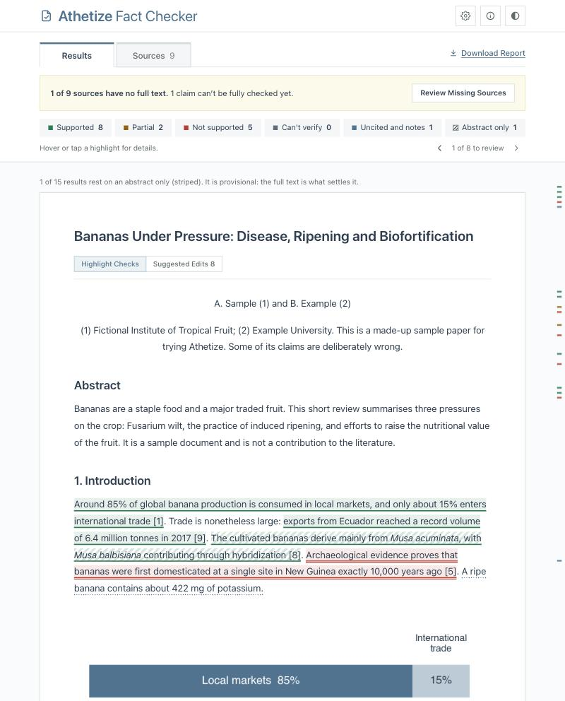
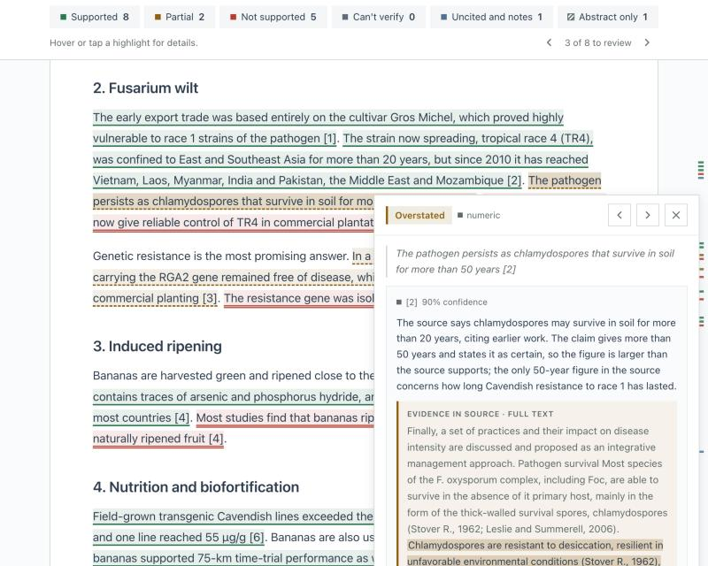
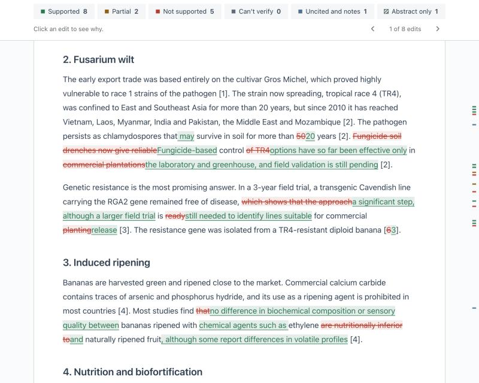
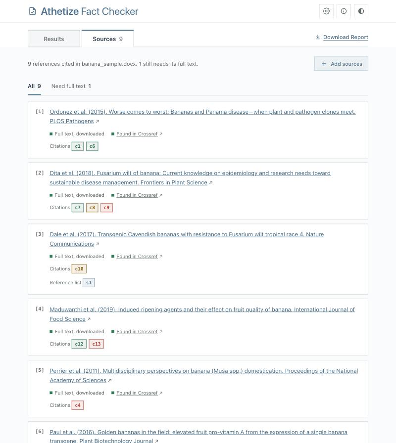
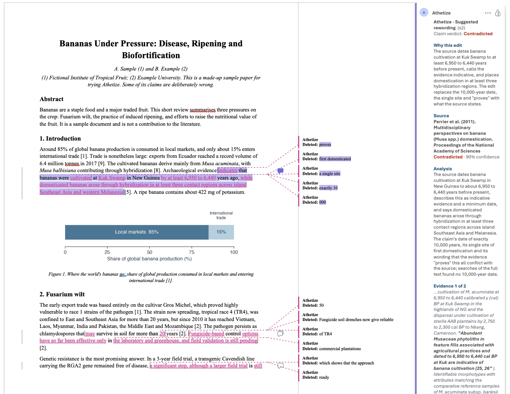

# Athetize Fact Checker

[](https://github.com/dividor/athetize-plugin-claude/actions/workflows/ci.yml)
[](LICENSE)

*To athetize: to mark a passage as spurious or unsupported.*

A Claude plugin that checks whether the sources a paper cites support what the paper says. It finds each claim, gets the cited source, compares the two, and shows the result on your paper with the evidence quoted. It is a screening aid: every flag still needs a human look.



## Install

**Claude Code**

```
/plugin install athetize --marketplace dividor/athetize-plugin-claude
```

On Claude Code older than 2.1.275, use two steps: `/plugin marketplace add dividor/athetize-plugin-claude`, then `/plugin install athetize@athetize-plugin`.

**Claude desktop app (Cowork) and claude.ai**

Open Customize, then Plugins, choose Add marketplace and enter `dividor/athetize-plugin-claude`. An organisation admin can add it for everyone under Organization settings, Plugins & skills.

**Without a marketplace**

The plugin is the [`athetize`](athetize) folder. Load a copy of it, or a zip of it, for one session:

```bash
claude --plugin-dir /path/to/athetize
```

Athetize is tested in Claude Code and the Claude desktop app. In claude.ai chat a plugin's agents are not used, and Athetize has not been tested there.

**Requirements**

Python 3.9 or newer with `defusedxml`, `lxml` and `pypdf`, the libraries Claude's own Word and PDF skills use. Claude checks for them when a check starts. If one is missing:

```bash
pip install defusedxml lxml pypdf
```

## Use

Ask Claude:

```text
Check the citations in draft.docx
```

Athetize reads the paper (Word, PDF, Markdown, LaTeX or text), downloads open-access copies of the sources, and asks you for the ones it could not get. You can point it at a folder of papers, pick files, or skip. Results go in a folder next to the paper:

- `report.html`: your paper with every claim highlighted, the evidence behind each result, and a Sources tab.
- A Word copy with each suggested edit as a tracked change and a comment that says why, for Word manuscripts.

## Example prompts

- "Check the citations in draft.docx"
- "Add the sources in ~/Papers and update the report"
- "Open the report so I can add sources"
- "Suggest fixes and give me a Word version with tracked changes"
- "Which papers do I still need to download?"

To try it without a paper of your own, check the sample in [examples](examples/README.md).

## Features

- **Claim-by-claim checking.** Every cited claim is compared with the text of its source. Each result quotes the passage it rests on, and a script confirms that the quote is really in the source.
- **Finds the sources.** Downloads open-access copies, follows addresses printed in a reference, and looks on the web for reports that have no record in the academic indexes.
- **Uses your files.** Point it at a folder or pick files. Each one is read and matched to its reference by its content, whatever it is called.
- **Interactive report.** One HTML file: your paper with its figures and tables, claims highlighted by result, filters, a card for each claim, and a Sources tab where missing sources can be added.
- **Suggested edits.** Rewordings bounded by the evidence, and fixes to the reference list. View them in the report, or download a Word copy with tracked changes and comments.
- **Reference checks.** Flags retracted sources and references whose year, title or DOI disagrees with the database record.
- **Fast rechecks.** After new sources or a new draft, only what changed is checked again.

| Result | Meaning |
| --- | --- |
| Supported | A passage in the source backs the claim. |
| Partial | Partly backed, or the claim goes further than the source. |
| Not supported | The source does not back the claim, or contradicts it. |
| Can't verify | The source could not be read. Never guessed. |
| Uncited | A specific claim with no citation. |

A result that rests on an abstract only is marked provisional.

Click a claim for the analysis, the quoted passage and a suggested rewording:



Switch to Suggested Edits to see every rewording and reference fix marked in the paper, as tracked changes:



The Sources tab shows where each source's text came from and lets you add the missing ones:



The Word copy, shown here in LibreOffice:



## What it runs, sends and fetches

- **Runs.** Python scripts in `athetize/scripts`, where Claude runs commands. If they are installed, the `pdftotext`, `pdftoppm` and `tesseract` tools to read PDFs. While you add sources from the report, a small web server on `127.0.0.1` that only the report page can reach; on a Mac it opens the system file chooser through `osascript`. It stops when you finish, or after two hours.
- **Sends.** Reference details only (titles, authors, DOIs), to find the sources: Crossref (`api.crossref.org`), OpenAlex (`api.openalex.org`), Europe PMC (`www.ebi.ac.uk`), arXiv (`arxiv.org`, `export.arxiv.org`), ERIC (`api.ies.ed.gov`, `files.eric.ed.gov`), Semantic Scholar (`api.semanticscholar.org`) and, if you set a contact email, Unpaywall (`api.unpaywall.org`). The email, when set, goes to these services as their contact address.
- **Fetches.** Full text from open-access copies, from addresses printed in a reference, and from files or addresses you provide.
- **Writes.** A `<paper>-check` folder next to your paper, and `~/.athetize/config.json` for settings.
- **Links.** The report links to `doi.org`, `scholar.google.com`, `search.worldcat.org`, `search.crossref.org`, `openalex.org` and `github.com`. Nothing is sent until you click.
- **Does not.** No hooks, no MCP servers, no telemetry, no bundled keys. Claude reads your paper and the sources; the scripts send neither anywhere.

See the [privacy policy](docs/privacy.md). To report a vulnerability, see [SECURITY.md](SECURITY.md).

## Troubleshooting

| Problem | What to do |
| --- | --- |
| A Python package is missing | `pip install defusedxml lxml pypdf` |
| A claim says "can't verify" | Its source could not be read. Add it from the Sources tab, or tell Claude where the file is. |
| Few sources were downloaded | Many papers are not open access. Set a contact email in the report's Settings to also try Unpaywall, or add the files yourself. |
| No Word copy | It is made only when the paper is a Word file. |
| Something else | [Open an issue](https://github.com/dividor/athetize-plugin-claude/issues). |

## Limitations

- The checking is done by AI and can be wrong. Read the quoted evidence before you change your paper.
- Without a source's text there is no result beyond "can't verify".
- Figures, tables and equations in sources are not interpreted, and scanned PDFs need OCR tools.

## More

- [docs/reference.md](docs/reference.md): every skill and agent, the files a check writes, and how results are kept honest.
- [CHANGELOG.md](CHANGELOG.md) and [CONTRIBUTING.md](CONTRIBUTING.md).

Development: `pip install -r requirements-dev.txt`, then `pytest`.

## License

[MIT](LICENSE)
